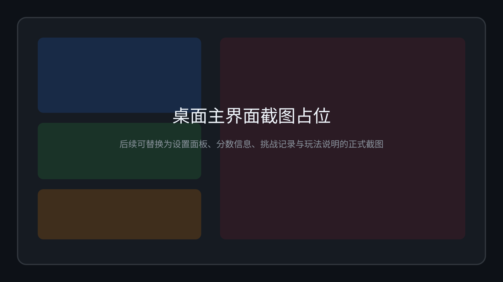
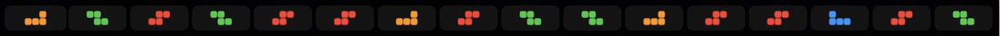

# Eliminate Teris 1

[简体中文](README.md) | English


A serious attempt to bring a match puzzle game onto the MacBook Touch Bar.

`Eliminate Teris 1` is a lightweight macOS puzzle game built for the Touch Bar. Swap adjacent tiles on a one-dimensional board of 16 slots and match three or more. Race to clear more tiles in one minute, or take your time planning thirty swaps.

The rules are easy to understand and quick to pick up. But once you actually start playing, you may realize that this small strip of Touch Bar still has enough room for judgment, tempo, tactile feedback, and that irresistible “one more round” feeling.

## Table of Contents

- [Screenshot Preview](#screenshot-preview)
- [Highlights](#highlights)
- [How to Play](#how-to-play)
- [Modes](#modes)
- [Interface Overview](#interface-overview)
- [Requirements](#requirements)
- [Quick Start](#quick-start)
- [Project Structure](#project-structure)
- [Why This Project Is Interesting](#why-this-project-is-interesting)

## Screenshot Preview

### Desktop Window



Ideally shows mode selection, live tile counts, challenge records, and the rules.

### Touch Bar Board



Ideally shows the 16-cell battlefield, swap actions, clear feedback, and refill rhythm.

## Highlights

### 1. The Touch Bar is the main stage
- The core gameplay happens directly on the Touch Bar instead of using it as a secondary shortcut area.
- All 16 interactive cells reflect the live board state, while swapping, clearing, refilling, animation, and sound all revolve around this strip.
- For a MacBook with a Touch Bar, this is not “a game that happens to support Touch Bar.” It is a game that treats the Touch Bar as the game itself.

### 2. One-dimensional matching that stays interesting
- The board is a horizontal line with `16` columns.
- You can only swap adjacent tiles.
- Matching `3` or more tiles of the same kind clears them.
- The game counts cleared tiles directly, with no point multiplier.
- After a clear, new tiles refill from the left side, creating a new rhythm and new opportunities.

Compared with traditional two-dimensional match games, this one-dimensional structure makes decision-making more focused. There is less visual noise and more instant judgment about whether the next move can extend into a better chain.

### 3. Three modes for practice, pace, and planning
- **Free Mode**: unlimited time and swaps for practice.
- **Timed Challenge**: clear as many tiles as possible in `60` seconds.
- **Swap Challenge**: clear as many tiles as possible in `30` swaps, with no time limit. The final swap and its cascades resolve fully.

### 4. Local challenge records
- Both challenge modes rank by tiles cleared. Equal counts share a rank; elapsed time does not break ties.
- New records use separate storage. Previous Score Attack and Speed Run results remain available under the previous-rules records section.
- Each record bucket keeps up to `9` entries so you can keep pushing your best results.

### 5. Audio feedback with a clear rhythm
- Different modes use different procedural BGM tracks.
- Swapping, clearing, and refilling each have their own sound effects.
- Audio is synthesized at runtime, so the project does not rely on external audio assets.

### 6. Multi-language support
- The game currently supports `Simplified Chinese`, `English`, `Japanese`, `Korean`, and `Russian`.
- The goal is not only localization, but also making this small and unusual game easier to approach for more players.

## How to Play

### Goal
Swap adjacent tiles to line up at least three identical tiles and clear as many as possible.

### Controls
- **Touch Bar tap**: select one tile first, then tap an adjacent tile to swap.
- **Touch Bar drag**: drag from one tile to a neighboring tile to swap directly.
- **Multi-touch**: multiple fingers are supported, which makes fast and continuous interactions feel much better.

### Counts and Swaps
- All cleared tiles, including refill cascades, count toward the round total. There are no point or combo multipliers.
- Every legal adjacent swap uses one move in Swap Challenge, even if it clears nothing.
- Selecting, cancelling, and invalid drags use no moves. Cascades cost no extra moves.

## Modes

### Free Mode
Best for your first few rounds. Time and swaps are unlimited, so you can learn the board and controls at your own pace.

### Timed Challenge
Clear as many tiles as possible in `60` seconds. The opening animation does not use any challenge time.

### Swap Challenge
Use `30` swaps to clear as many tiles as possible. There is no countdown. Swaps without a match still count, and all cascades from the final swap resolve before the round ends.

## Interface Overview

This `experiment/ui-refactor` branch uses a light desktop dashboard with a hero area, mode cards, live round statistics, and an achievement strip.

- **Game Modes**: choose Free Mode, Timed Challenge, or Swap Challenge with fixed rules. Start with the main button, Space, or the Touch Bar slider.
- **Cleared Tiles**: live totals and four tile-type counts for this round. Restarting or switching modes clears them; lifetime achievement progress remains saved.
- **Navigation**: records, rules, and settings open separate panels. Settings contain language and master volume.
- **Achievements**: completion progress, five badges, and access to the full collection.

In other words, this is not just “a Touch Bar strip doing something.” It is a complete play experience made of a Touch Bar battlefield and a desktop information panel.

## Requirements

### For Players
- macOS `12.0` or later
- A MacBook Pro with **Touch Bar** for the full intended experience

### For Developers
- Xcode and a working Swift development environment
- Command line tools such as `swift`, `codesign`, and `hdiutil`

> The app may still launch on a machine without a Touch Bar, but the core gameplay experience depends heavily on it.

## Quick Start

### 1. Run locally
The repository includes a launch script:

```bash
./run.sh
```

This script rebuilds before launch so you do not accidentally start an outdated binary. In short, it:

1. Resolves the Xcode Developer directory automatically if `DEVELOPER_DIR` is not set manually
2. Runs `swift build --disable-sandbox`
3. Resolves the output binary path automatically
4. Launches `Eliminate Teris 1`

### 2. Package for distribution
To generate a distributable `.app`, `.dmg`, or `.zip`, run:

```bash
./package.sh
```

The packaging script will:
- Build both `x86_64` and `arm64`
- Merge them into a universal binary with `lipo`
- Copy the SwiftPM resource bundle automatically
- Generate `Info.plist`
- Apply ad-hoc signing
- Prefer a `.dmg`, and fall back to `.zip` if DMG creation is unavailable

Artifacts are generated in:

```bash
dist/
```

If you only want one architecture, you can override the environment variable:

```bash
PACKAGE_ARCHS="arm64" ./package.sh
```

## Project Structure

```text
.
├── Sources/
│   ├── AppDelegate.swift
│   ├── GameViewController.swift
│   ├── GameTouchBarView.swift
│   ├── GameState.swift
│   ├── GameAudioSystem.swift
│   ├── ModeRecordStore.swift
│   └── Resources/
├── run.sh
├── package.sh
└── Package.swift
```

Key files at a glance:

- `Sources/GameTouchBarView.swift`: Touch Bar board rendering, interaction, and animation
- `Sources/GameState.swift`: board state, match detection, clearing, and left-side refill logic
- `Sources/GameViewController.swift`: event coordination, fixed mode selection, result recording, and Touch Bar lifecycle
- `Sources/HomeDashboardView.swift`: light dashboard and live round statistics
- `Sources/GamePresentation.swift`: fixed rules and shared rendering style
- `Sources/HomeUtilityPanel.swift`: navigation panels
- `Sources/ModeRecordStore.swift`: local challenge record storage and ranking
- `Sources/GameAudioSystem.swift`: procedural BGM and sound effects
- `Sources/Localization.swift`: language switching and resource bundle lookup

## Why This Project Is Interesting

Most Touch Bar software treats the Touch Bar as a shortcut row or a secondary display. `Eliminate Teris 1` asks a different question:

**What happens if the Touch Bar is not a side feature, but the main stage?**

This project suggests that:
- a real game can live there,
- feedback and rhythm can still feel satisfying,
- even a tiny interface area can hold strategy and challenge,
- and a piece of hardware that is often ignored can become fun again.

## Notes

- The current official Touch Bar path favors the public `window.touchBar` route for better development and packaged-build stability.
- Available Touch Bar width and system-reserved space may differ slightly across macOS versions and hardware.
- At this stage, the project is best understood as a distinctive Touch Bar-focused game and experiment rather than a general-purpose casual game for every Mac.

## Who This Is For

You may especially enjoy this project if:

- you still use a MacBook with Touch Bar and want to see it act more like a device and less like an accessory,
- you like compact games with simple rules and clear pacing,
- you are interested in macOS native development, Touch Bar interaction, or unconventional UI surfaces,
- or you want to study a lightweight native project structure built with public APIs, SwiftPM, and manual packaging.

## Closing

`Eliminate Teris 1` is not trying to be a huge content-heavy game. It is a small work with a very clear personality: the satisfaction of match-clearing, the uniqueness of the Touch Bar, and a bit of pixel-arcade flavor compressed into a narrow but surprisingly playful space.

If you also like things that are small but fun, feel free to follow and leave a comment.
