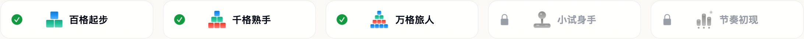
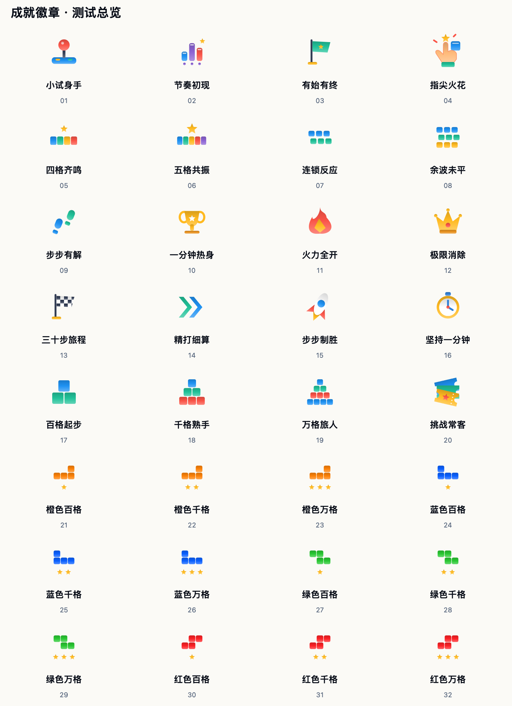

# 游戏界面测试图

这些文件仅用于开发测试与评审，正式应用中没有图标预览按钮或图标预览页面。

## 触控栏滑动开局

- [查看开局动画](touchbar-start.gif)：待机滑轨与按钮触发的从左到右自动显现，使用真实 `GameTouchBarView` 导出。
- [查看三种状态](touchbar-start-states.png)：等待开始、滑动半程、正式 16 格棋盘。
- 开局动画结束后才计时；未完成松手回弹，开局手指抬起后才接受交换。减少动态效果开启时跳过自动过渡。
- 测试使用独立存档和可控时钟，不挂载玩家的真实 Touch Bar。

重新生成：`DEVELOPER_DIR=/Applications/Xcode.app/Contents/Developer swift test --filter GameStartSequenceTests`。

将临时目录中的 `eliminate-touchbar-start.gif` 与 `eliminate-touchbar-start-states.png` 分别复制为本目录对应文件。

## 游戏设置、玩法说明与挑战记录

三个辅助面板共用首页的暖白背景、圆角卡片、蓝色信息色和黄色强调色。

- [游戏设置](utility-settings.png)：语言选择卡片、金色音量滑杆、实时百分比与即时生效提示。
- [玩法说明](utility-rules.png)：三步操作示意、固定模式规则和本局/累计进度说明。
- [竞分排行榜](utility-records.png)、[竞速排行榜](utility-records-speed.png)：带滑动过渡的模式切换、个人最佳、金银铜名次及对齐的记录列。
- [暂无记录状态](utility-records-empty.png)：显示空榜单提示，不生成虚构成绩。
- 上述截图中的成绩来自隔离测试存档；正式应用没有测试预览入口。
- 小窗口可滚动查看内容，系统减少动态效果开启时切换立即完成。

重新生成辅助面板截图：

```sh
DEVELOPER_DIR=/Applications/Xcode.app/Contents/Developer swift test --filter HomeUtilityPanelTests
```

将临时目录中的 `eliminate-utility-*.png` 复制为本目录对应的 `utility-*.png`；`*-compact-ru.png` 仅用于长翻译与紧凑窗口检查，无需归档。

## 筛选切换动画


- 共用暖白轨道，黄色选中滑块在全部、未解锁、已解锁之间移动，显示对应数量。
- 过渡时长 0.24 秒，快速切换从当前视觉位置接续；系统减少动态效果开启时即时切换。
- 动画由真实 Core Animation（核心动画）展示层导出，测试入口不进入正式应用。
- [查看成就页完整效果](achievement-panel.png)。页头仅显示“成就”与彩色奖章；页面中的进度和时间来自隔离测试存档。

## 标签实际效果



- 使用首页真实标签组件渲染，重点展示“百格起步”“千格熟手”和“万格旅人”的尺寸与居中效果。
- [全屏尺寸标签效果](achievement-labels-fullscreen.png)：1920 宽度下每枚标签的状态标记固定左侧，成就图案与名称单独在卡片中心对齐；缩回窄窗口时长名称按最终省略文本重新居中。
- 截图中的解锁状态来自独立的测试存档，不修改玩家存档。

## 全部 32 枚徽章



- 图标入口：`Sources/GameIcons.swift` 中的 `AchievementIconCatalog`。
- 游戏主题绘制：`Sources/AchievementBadgeArtwork.swift`，使用无外框、无底板的彩色摇杆、节拍光柱、指尖消除火花、纯脚印、挑战票券等游戏图案。
- 总累计百/千/万图案仅保留两、三、四层方块，不含五角星；调整单格尺寸以保持整体大小接近并居中。
- 四种类型的百/千/万档分别使用一、二、三颗星。
- 测试总览夹具：`Tests/AchievementIconContactSheet.swift`，只编入 XCTest target，不进入正式 App。

## 更新测试图

```sh
DEVELOPER_DIR=/Applications/Xcode.app/Contents/Developer swift test --filter GameIconPresentationTests
```

将系统临时目录中的 `eliminate-all-achievement-icons.png` 和 `eliminate-game-badge-labels.png` 分别复制为本目录中的 `achievement-icons.png` 和 `achievement-labels.png`；`eliminate-fullscreen-badge-labels.png` 复制为 `achievement-labels-fullscreen.png`。

更新筛选条动画与完整成就页截图：

```sh
DEVELOPER_DIR=/Applications/Xcode.app/Contents/Developer swift test --filter AchievementFilterControlTests
```

将临时目录中的 `eliminate-achievement-filter.gif` 和 `eliminate-achievement-panel-refined.png` 分别复制到本目录的 `achievement-filter.gif` 和 `achievement-panel.png`。
